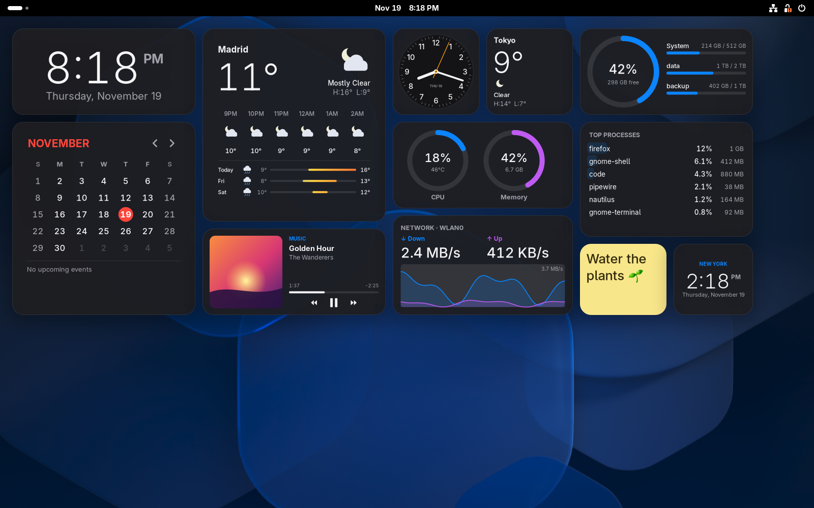

# gnomlets

macOS-style desktop widgets for GNOME Shell. They sit on the wallpaper, below
every window, and you can drag them anywhere, resize them from their
bottom-right corner, and snap them to each other's edges. The idea comes from
[hasklets](https://github.com/prietus/hasklets). That project needs
wlr-layer-shell, which GNOME doesn't have, so gnomlets is written as a Shell
extension instead.



## Widgets

| Widget | What it shows |
|---|---|
| **Clock** | Large time and date. It can show another city's time zone. |
| **Analog Clock** | A clock face with numbers, a second hand and an optional time zone. |
| **Calendar** | The month and your upcoming events, read from the calendars in GNOME Online Accounts and Evolution through the Shell's own calendar server. Scroll or use the arrows to change month. |
| **Weather** | Current conditions from [Open-Meteo](https://open-meteo.com) (no API key). A larger widget also shows the next hours and the week ahead. |
| **Now Playing** | Cover art, track, progress bar and previous / play-pause / next for any MPRIS player. |
| **System** | CPU and memory gauges. When it is larger, it also shows CPU history, every core, load and uptime. |
| **Network** | Download and upload speed, with a minute of history. |
| **Disks** | Used and free space on every mounted filesystem. |
| **Processes** | The processes using the most CPU or memory. |
| **Battery** | Charge, charging state and time left. |
| **Note** | A sticky note in six colors. Double-click it to edit. |

Every widget reflows its content when you resize it. Most look like the macOS
small, medium and large widgets at their preset sizes.

## Install

Requires GNOME Shell 51.

### From extensions.gnome.org

Coming soon.

### From source

```sh
git clone https://github.com/prietus/gnomlets.git
cd gnomlets
make install          # copies to ~/.local/share/gnome-shell/extensions
# log out and back in (on Wayland the Shell can't reload extensions)
make enable
```

`make link` symlinks the folder instead of copying it, for development.
`make zip` builds the package for extensions.gnome.org.

## Using it

* **Add**: right-click the desktop and choose **Add Widget**. The widget
  appears where you clicked. You can also use the **Gallery** page in the
  preferences (`make prefs`).
* **Move**: drag with the left button. While you drag, the widget snaps to the
  edges of other widgets and of the screen, with the spacing you set in the
  preferences.
* **Resize**: move the pointer over a widget and drag the arc that appears in
  its bottom-right corner. Right-click → **Size** jumps to Small, Medium or
  Large.
* **Options**: right-click a widget for its own options (24-hour format,
  Fahrenheit, note color…), **Duplicate**, **Lock Widgets**, **Widget
  Settings…** and **Remove Widget**.
* **Preferences**: there are three pages.
  * **Gallery** adds widgets.
  * **On Desktop** lists your widgets with their settings. Here you search for
    a city for the weather or a world clock, and edit notes.
  * **Appearance** has the theme (automatic, dark, light, glass, Catppuccin
    Mocha, Nord, Gruvbox), card opacity, snapping, spacing, lock, **Tidy Up**
    and **Remove All**.

Everything is saved in GSettings (`org.gnome.shell.extensions.gnomlets`). The
`widgets` key is a JSON list of `{id, type, x, y, w, h, opts}`, and you can
edit it by hand: a missing `x`/`y` places the widget automatically, and a
missing `w`/`h` uses the widget's default size.

## How it works

* The widgets live in a layer inside `Main.layoutManager._backgroundGroup`.
  That puts them above the wallpaper and below windows, and keeps them out of
  the overview.
* Each widget is a frame (`lib/frame.js`) holding a card, an `St.DrawingArea`
  that the widget draws on with cairo and Pango, and an overlay for real
  actors such as cover art. The frame handles dragging and resizing with a
  stage grab, and opens the right-click menu.
* `extension.js` loads and saves the layout, places new widgets in free space,
  computes snapping, builds the menus and adds **Add Widget** to the desktop's
  right-click menu.
* `lib/sysinfo.js` has shared samplers for `/proc` and `/sys`. Each one polls
  only while a widget is subscribed to it.
* `lib/catalog.js` holds each widget type's metadata. It is plain data, so
  `prefs.js` (GTK 4 / libadwaita) can import it without loading Shell modules.

To add a widget, create a class in `widgets/` that extends `Gnomlet` and
implements `draw(cr, w, h, theme)`, and optionally `enable`, `click`, `scroll`,
`buildMenu` and `layout`. Then register it in `widgets/index.js` and
`lib/catalog.js`.

## License

[MIT](LICENSE)
